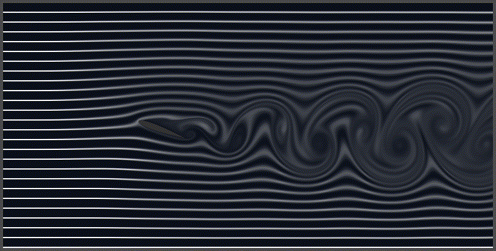

# LBM Wind Tunnel

A real-time 2D virtual wind tunnel built with Godot 4.2, using the Lattice Boltzmann Method. 
Find detailed physical explanations on my website.

## Media & Recording
Screenshots and GIFs are automatically saved in the `recording/` directory. 
To enable GIF recording, you must install [FFmpeg](https://ffmpeg.org/) and set your executable path in the `FFMPEG_PATH` variable inside `wing_config.gd`.

## Controls
- **V** : Change view mode
- **H** : Hide the HUD
- **N** : Record a GIF
- **S** : Take a screenshot
- **Up / Down arrows** : Change Reynolds number (Re)
- **Left / Right arrows** : Change wing angle